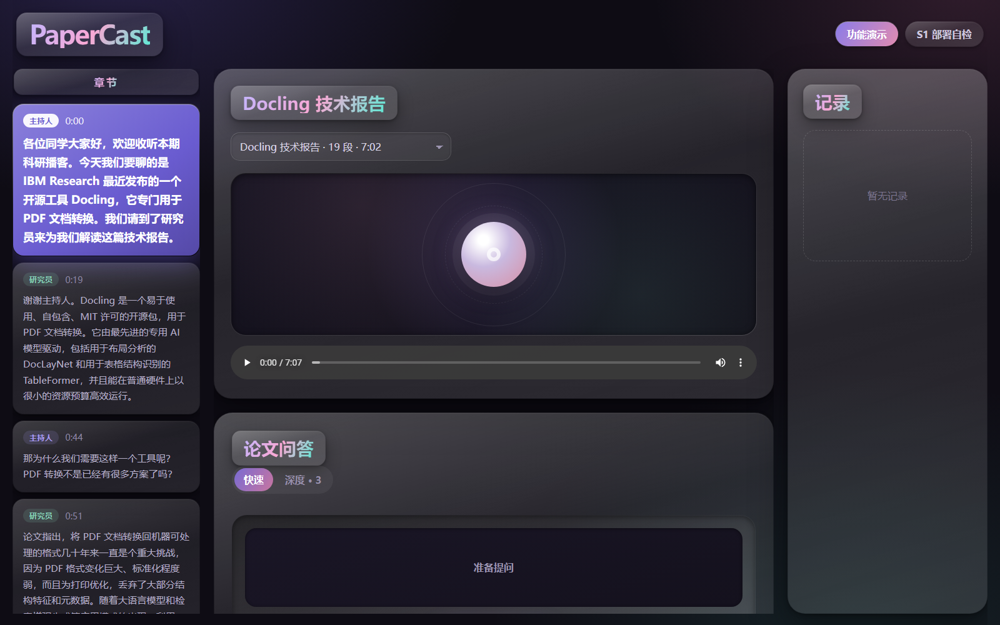
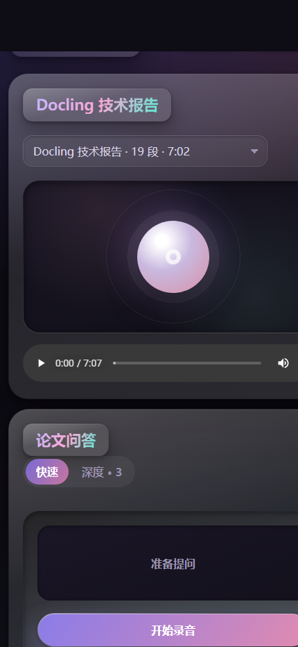
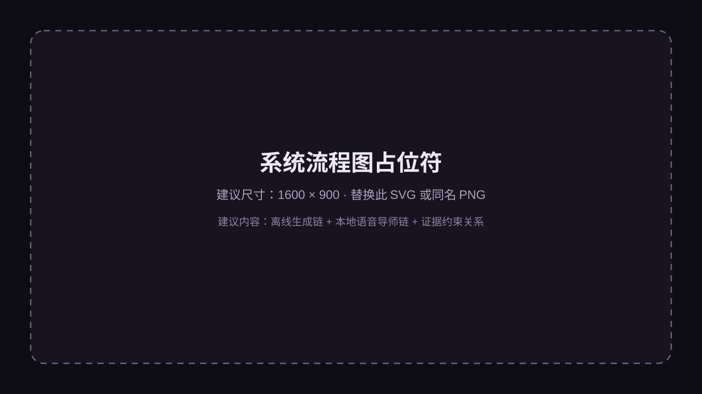
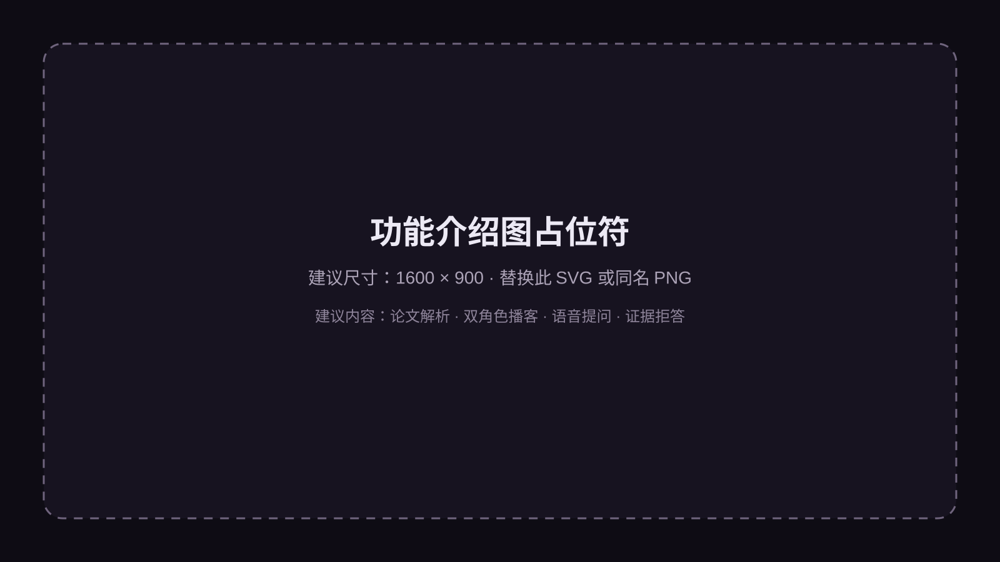

# PaperCast AI

把科研 PDF 转成可听、可问、受证据约束的中文双角色播客。

[在线体验](https://papercast-ai-koyte7vo1mh.qoder.zone) · [本地 PoC 文档](papercast-poc/README.md) · [演示站文档](papercast-site/README.md)

> 本仓库保留完整的本地原版技术链路：Docling 解析、证据构建、DeepSeek 脚本生成、双音色 TTS、faster-whisper、Qdrant Hybrid 检索和 React 播放问答界面。公网版本为适配边缘运行环境的轻量部署版。

## 界面



<details>
<summary>移动端界面</summary>



</details>

## 系统流程图



> 可编辑系统流程图由项目作者后续补充。建议保留两条主线：`PDF → 播客` 的离线生成链，以及 `语音提问 → 证据回答` 的本地导师链。

## 功能介绍图



## 核心能力

- **论文解析**：Docling 提取版面、正文和表格，保留页码与章节信息。
- **证据化播客**：DeepSeek 生成主持人/研究员双角色脚本，事实段绑定证据 ID 并进行代码校验。
- **双音色语音**：支持本地 Qwen3-TTS；演示资源使用预生成神经语音，按段定位和跳转。
- **混合检索**：Qdrant 稠密向量、BM25 与 RRF 融合，支持中文问题检索英文论文内容。
- **语音导师**：faster-whisper 转写，DeepSeek 仅依据检索证据回答；无证据时明确拒答。
- **播放闭环**：提问时暂停，回答后恢复原播放位置，并保留当前会话记录。

## 本地原版流程

```text
PDF
 └─ Docling → paper.json → evidence_pool.json
                              ├─ DeepSeek → 双角色 script.json → Qwen3-TTS → 分段音频
                              └─ Qdrant Hybrid ← faster-whisper ← 浏览器录音
                                      └─ DeepSeek 证据回答 → React 页面 → 恢复播放
```

本地链路以质量和可评测性为目标；公网链路以无需本地模型、快速打开和低运维成本为目标。两者共用相同的论文、章节和证据约束原则。

## 仓库结构

```text
.
├─ papercast-poc/          # Python 本地原版：解析、证据、脚本、TTS、ASR、检索与评测
│  ├─ src/papercast_poc/  # 核心适配器与导师逻辑
│  ├─ scripts/            # 可独立运行的实验/流水线入口
│  ├─ tests/              # Python 测试
│  └─ reports/            # 实验、验收与许可记录
├─ papercast-site/         # React + Vite 演示界面与边缘函数
│  ├─ src/
│  ├─ functions/
│  └─ public/             # 预生成节目数据与演示音频
└─ docs/                   # 架构占位图和真实界面截图
```

## 快速运行演示站

```powershell
cd papercast-site
npm ci
npm run build
npm run preview
```

打开终端显示的 preview 地址。静态论文数据和音频已经包含在仓库中；preview 不模拟问答函数。需要本地 Python 问答时，启动下面的服务并改用 `npm run dev`。

## 运行本地完整链路

### 1. 环境

- Python 3.11
- Node.js 18+
- [uv](https://docs.astral.sh/uv/)
- NVIDIA GPU（本地 ASR/TTS 推荐，不是静态站必需）
- DeepSeek API Key
- Qdrant Cloud 或自托管 Qdrant（可选；未配置时保留关键词回退）

```powershell
cd papercast-poc
uv sync --extra llm --extra asr --extra tts
Copy-Item .env.example .env
```

在 `.env` 中填写 `DEEPSEEK_API_KEY`；如启用混合检索，再填写 `QDRANT_URL` 和 `QDRANT_API_KEY`。`.env` 已被 Git 忽略。

### 2. 从 PDF 生成节目

```powershell
# 解析 PDF
uv run python scripts/experiment_pdf.py inputs/your-paper.pdf `
  --paper-id your_paper `
  --out-dir outputs/papers/your_paper/pdf_parse

# 生成证据约束的双角色脚本
uv run python scripts/experiment_podcast.py `
  --paper-json outputs/papers/your_paper/pdf_parse/paper.json `
  --out-dir outputs/papers/your_paper/podcast

# 本地 Qwen3-TTS 合成全部段落（--segments 0 表示全部）
uv run python scripts/experiment_tts.py `
  --script-json outputs/papers/your_paper/podcast/script.json `
  --out-dir outputs/papers/your_paper/tts `
  --segments 0
```

### 3. 建立检索并启动本地服务

```powershell
uv run python scripts/index_qdrant.py `
  --pipeline-dir outputs/papers/your_paper

uv run python scripts/serve_local.py `
  --port 8000 `
  --pipeline-dir outputs/papers/your_paper `
  --warmup
```

另开一个终端运行 `papercast-site`：

```powershell
cd papercast-site
npm run dev
```

Vite 会把本地 `/api` 与 `/audio` 请求代理到 `127.0.0.1:8000`。

## 测试

```powershell
cd papercast-poc
uv run pytest

cd ../papercast-site
npm run build
deno test --allow-env functions/handler.test.ts
```

## 数据与安全

- `.env`、模型权重、源 PDF 和本地生成目录不会提交到 Git。
- 仓库中的音频和 JSON 仅用于演示预置论文流程。
- API Key 只由服务端读取，前端构建不包含密钥。
- 请只处理你有权使用的论文；本仓库不分发原始论文 PDF。

## 当前范围

- 已提供 10 篇预生成中文播客，单篇 16–20 段。
- 公网版本支持播放、章节跳转、文字/语音输入和受限的 DeepSeek 深度问答。
- 在线上传 PDF 尚未接入前端；完整解析流程目前通过本地脚本运行。

更多实验结果、许可核验和验收记录见 [`papercast-poc/reports`](papercast-poc/reports)。
