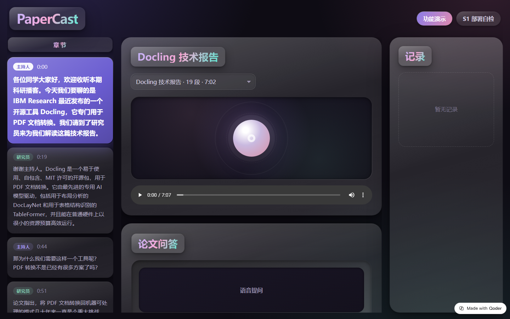
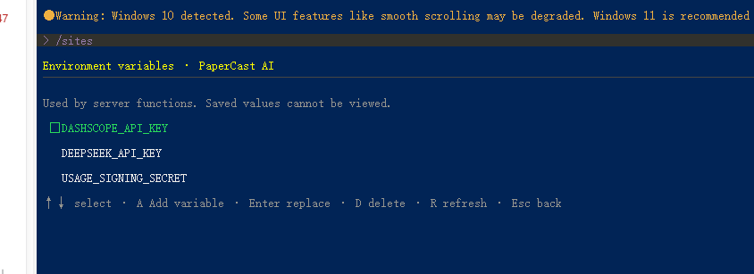

# 作品帖终稿 — PaperCast AI

> 发布前仍需补演示视频链接（如有），并插入一张不含密钥的 Qoder 开发过程截图。

## 标题

**【Hack4Good】PaperCast AI——为注意力容易分散的科研学习者，把论文变成可听、可问的中文播客**

参赛赛道：**Hack4Good 技术向善（认知无障碍科研）**

## 在线体验

- 公网产品：https://papercast-ai-koyte7vo1mh.qoder.zone
- 开源代码：https://github.com/zhouzhou-cnqd/PaperCast-AI
- 演示视频：**[请粘贴视频链接；没有可删除本行]**
- 天池团队 ID：**1398649**
- Qoder 账号：**nick6916784719**

原创声明：本作品为本次大赛期间完成的原创作品，使用 Qoder 开发并部署到 Qoder Sites。

## 一、自我介绍

我们是一支跨校研究生团队。安玖箐是西北工业大学人工智能专业研二学生，关注大模型、语音交互与科研工具；曹雪雅是陕西师范大学应用统计专业研一学生，关注如何用数据和交互降低学习负担。我们希望把技术用于注意力容易分散的科研学习者，让密集论文内容更容易开始、更容易持续，也能在产生疑问时及时获得有依据的回答。

## 二、我的作品是什么

PaperCast AI 是一款面向注意力容易分散、难以长时间阅读论文的科研学习者的认知无障碍工具：它把英文论文转换成双角色中文播客，并允许用户在收听过程中基于论文完整文本随时提问。

比赛版已经上线 10 篇论文、183 个播客段落，总时长约 45 分钟。它可以在手机和桌面浏览器中直接使用，无需登录、无需安装模型，也无需用户提供 API Key。



## 三、为什么做

论文阅读需要长时间维持注意力。对容易在长篇阅读中注意力漂移、阅读负荷过高的学习者来说，信息并不是不存在，而是难以持续进入。音频可以把阅读转换为通勤、散步等场景中的收听，但普通朗读又缺少结构和互动。

因此 PaperCast 不直接朗读 PDF，而是先理解论文结构与证据，再把内容改写成主持人与研究员的双角色中文播客；用户听到疑问时，可以立刻用文字或语音提问，回答后从原位置继续收听。我们的目标不是替代论文，而是降低开始阅读和维持注意力的门槛。

## 四、怎么用（5 步以内）

1. 打开公网地址，在下拉列表选择一篇论文。
2. 点击播放收听双角色中文播客，或点击左侧章节直接跳转。
3. 在“论文问答”中输入问题；也可以点击开始录音、再次点击停止，让通义千问先转成可编辑文字。
4. 点击“提问”，阅读基于当前论文完整解析文本生成的回答。
5. 点击“继续播放”，从提问前的位置接着收听；右侧记录保留本次会话最近 10 条问答。

## 五、我如何使用 Qoder 做出来

1. 我先向 Qoder 描述“论文播客 + 听中提问 + 回到原位置”的核心闭环，并用可操作的验收标准约束功能。
2. Qoder 协助实现 React/Vite 三栏响应式界面、章节联动、播放位置恢复、录音波形和会话记录。
3. Qoder 将本地 Python 原版拆分为适合公网的静态资源与 Deno Function：重任务离线生成，线上承担播放、检索、通义千问 ASR 和 DeepSeek 问答。
4. 我用真实桌面和手机反馈持续要求 Qoder 调整布局、移除冗余信息、修复语音权限与问答质量问题。
5. 最后通过 Qoder CN CLI 配置服务端 Secret、运行构建与测试，并发布到 Qoder Sites 公网地址。



图中展示 Qoder CN Sites 的服务端环境变量配置界面；Secret 仅显示名称，保存后的值不可查看，也不会进入浏览器代码。

## 六、核心体验

### 1. 把英文论文变成可听的中文对谈

Docling 提取正文、章节、页码和表格信息，DeepSeek 根据证据生成双角色脚本，TTS 再合成两种音色。每篇节目有 16–20 段，可以点击章节跳转、拖动播放，并看到当前段落随进度联动。

### 2. 完整论文文本 + DeepSeek 深度问答

我们把 10 篇论文的完整 Docling 解析结果嵌入服务端，共 12,758 个文本块。提问时，Qoder Function 先把检索范围锁定在当前论文，选择最多 10 条候选证据，再调用 DeepSeek 组织“核心结论—方法机制—实验依据与局限”的中文回答。

应用内不限制深度问答次数。API Key 始终只保存在服务端，浏览器中没有密钥，也不会直接收到论文原文。

### 3. 无依据就明确拒答

检索不到相关论文证据时，系统必须以“论文未提供”或“我不确定”开始回答，并清空证据编号。模型返回后还会经过代码级 evidence ID 校验，避免引用不存在的内容。

### 4. 听到哪，回答后回到哪

提问时记录当前播放位置和章节。回答结束后，用户可以继续从原位置收听；最近 10 条问题保存在当前会话记录中。


## 七、系统架构


项目包含两条有意分开的链路：

```text
内容生成 / 本地完整原版
PDF → Docling → 证据池 → DeepSeek 双角色脚本 → 双音色 TTS
                       └→ Qdrant Hybrid ← faster-whisper ← 本地语音提问

公网比赛版
React 播放器 + 文字提问 / 可选语音输入
  ├→ 静态音频与章节数据
  └→ Qoder Deno Function
       ├→ 通义千问 ASR：录音转成可编辑文字
       └→ 12,758 个全文块检索 → 最多 10 条证据 → DeepSeek
```

本地原版以研究质量和完整技术链路为目标；公网版以打开即用、移动端稳定和服务端安全为目标。我们没有把几百 MB 的 ASR/TTS 模型塞进边缘函数，也没有要求用户在公开页面输入自己的密钥。

## 八、实测结果

| 指标 | 结果 |
|---|---|
| 公网内容库 | 10 篇、183 段、约 45 分钟 |
| 完整解析语料 | 12,758 个 Docling 文本块 |
| 公网深度问答样例 | 最终回归 381 个字符、6 条证据；扩展样例 467 个字符、9 条证据 |
| 公网全文检索旧 10 问回归 | 10/10 命中 |
| Deno 函数测试 | 10/10 通过 |
| 前端构建 | TypeScript + Vite 通过 |
| 本地 Qdrant 检索 | 10/10 Top-3 命中 |
| 本地真实语音稳定性 | 20/20 成功，无崩溃、无论文串线 |
| 本地问答延迟 | 平均 3.68 秒，P95 4.0 秒，全部小于 10 秒 |
| Python 测试 | 16 项通过 |

公网与本地指标分开报告：3.68 秒属于本地 faster-whisper + Qdrant + DeepSeek 链路，不用它冒充云端延迟。

## 九、我们做过的关键取舍

- **语音是可选入口，不是单点依赖**：用户点击开始、再次点击停止，通义千问 ASR 把问题转成可编辑文字；麦克风权限或识别失败时，文字输入始终可用。
- **只保留证据约束的深度问答**：概括型问题不再经过脆弱的关键词短路；外部模型不可用时明确提示，不用低质量答案冒充可用结果。
- **预生成播客**：Docling、LLM 脚本和 TTS 是重任务，放在离线流水线中完成；线上只承担播放、检索和问答，更符合边缘部署边界。
- **原文只在服务端检索**：公开响应不提供 `quote` 或 `passage_text`，兼顾回答依据与内容保护。
- **取消应用内问答次数限制**：评委可以连续体验完整问答；密钥仍只在服务端，并保留请求大小、输入长度和超时保护。

## 十、已知限制与下一步

- 当前是 10 篇精选论文的预置内容库，尚未提供网页上传 PDF。
- 互动回答只输出文字，尚未加入低延迟流式语音回复。
- 深度问答依赖外部大模型服务，仍受 API 余额、并发和服务状态影响。
- 下一步会把上传、异步解析、个人论文库和学习目标选择接入同一套证据化流水线。

## 团队与致谢

- 团队名称：**zhouzhouYA**
- 成员：**安玖箐、曹雪雅**
- 学校/专业/年级：**西北工业大学·人工智能·研二；陕西师范大学·应用统计·研一**
- 天池团队 ID：**1398649**
- Qoder 账号：**nick6916784719**

感谢 Qoder 高校创造力大赛，以及 Docling、Qdrant、faster-whisper、DeepSeek、通义千问、React/Vite 等项目与服务。
