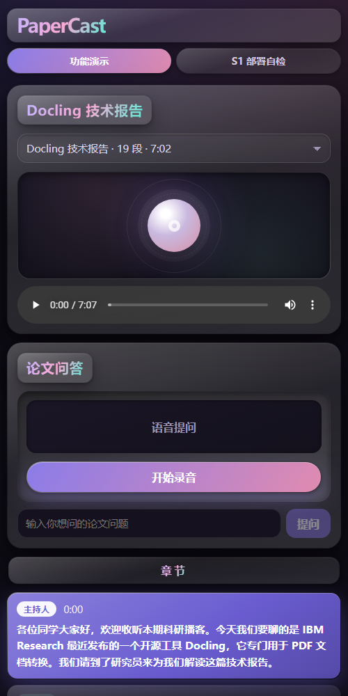
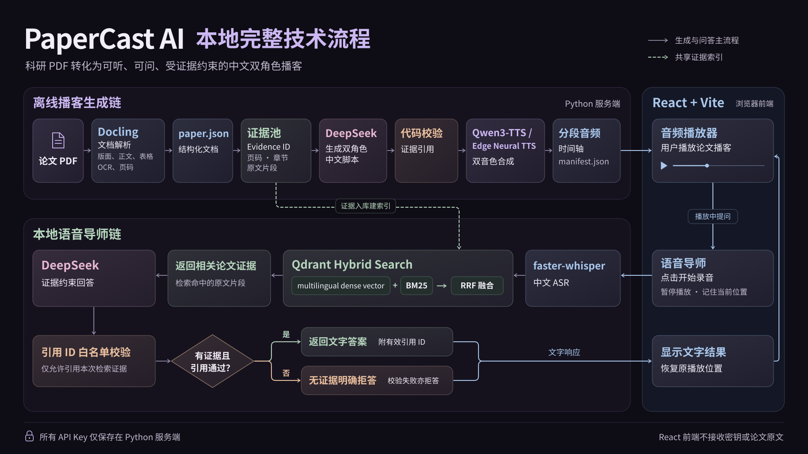

# 作品帖终稿 — PaperCast AI

> 发布前只需填写文末团队信息和演示视频链接。

## 标题

**PaperCast AI：把论文变成双人中文播客，听到哪、问到哪**

参赛赛道：**Hack4Good 技术向善（认知无障碍科研）**

## 在线体验

- 公网产品：https://papercast-ai-koyte7vo1mh.qoder.zone
- 开源代码：https://github.com/zhouzhou-cnqd/PaperCast-AI
- 演示视频：**[请粘贴视频链接]**

## 为什么做 PaperCast

论文阅读需要长时间专注，对容易在长篇阅读中注意力漂移、阅读负荷过高的学习者尤其困难。PaperCast 面向认知无障碍科研场景：它不是简单朗读 PDF，而是先理解论文结构和证据，再把内容改写成主持人与研究员的双角色中文播客；用户听到疑问时，可以直接用文字或语音提问。

比赛版已经上线 10 篇论文、183 个播客段落，总时长约 45 分钟。它可以在手机和桌面浏览器中直接使用，无需登录、无需安装模型，也无需用户提供 API Key。


## 核心体验

### 1. 把英文论文变成可听的中文对谈

Docling 提取正文、章节、页码和表格信息，DeepSeek 根据证据生成双角色脚本，TTS 再合成两种音色。每篇节目有 16–20 段，可以点击章节跳转、拖动播放，并看到当前段落随进度联动。

### 2. 深度问答：完整论文文本 + DeepSeek

我们把 10 篇论文的完整 Docling 解析结果嵌入服务端，共 12,758 个文本块。深度提问时，Qoder Function 先把检索范围锁定在当前论文，选择最多 10 条候选证据，再调用 DeepSeek 组织“核心结论—方法机制—实验依据与局限”的中文回答。

每位访客最多体验 3 次深度问答。额度校验和 API Key 都在服务端，浏览器中没有密钥，也不会直接收到论文原文。

### 4. 无依据就明确拒答

检索不到相关论文证据时，系统必须以“论文未提供”或“我不确定”开始回答，并清空证据编号。模型返回后还会经过代码级 evidence ID 校验，避免引用不存在的内容。

### 5. 听到哪，回答后回到哪

提问时记录当前播放位置和章节。回答结束后，用户可以继续从原位置收听；最近 10 条问题保存在当前会话记录中。



## 系统架构



项目包含两条有意分开的链路：

```text
内容生成 / 本地完整原版
PDF → Docling → 证据池 → DeepSeek 双角色脚本 → 双音色 TTS
                       └→ Qdrant Hybrid ← faster-whisper ← 本地语音提问

公网比赛版
React 播放器 + 文字提问 / 可选语音输入
  ├→ 静态音频与章节数据
  └→ Qoder Deno Function
       ├→ 通义千问 ASR：录音转成可编辑文字
       └→ 12,758 个全文块检索 → 最多 10 条证据 → DeepSeek
```

本地原版以研究质量和完整技术链路为目标；公网版以打开即用、移动端稳定和服务端安全为目标。我们没有把几百 MB 的 ASR/TTS 模型塞进边缘函数，也没有要求用户在公开页面输入自己的密钥。

## 实测结果

| 指标 | 结果 |
|---|---|
| 公网内容库 | 10 篇、183 段、约 45 分钟 |
| 完整解析语料 | 12,758 个 Docling 文本块 |
| 公网深度问答样例 | 最终回归 381 个字符、6 条证据；扩展样例 467 个字符、9 条证据 |
| 公网全文检索旧 10 问回归 | 10/10 命中 |
| Deno 函数测试 | 9/9 通过 |
| 前端构建 | TypeScript + Vite 通过 |
| 本地 Qdrant 检索 | 10/10 Top-3 命中 |
| 本地真实语音稳定性 | 20/20 成功，无崩溃、无论文串线 |
| 本地问答延迟 | 平均 3.68 秒，P95 4.0 秒，全部小于 10 秒 |
| Python 测试 | 16 项通过 |

公网与本地指标分开报告：3.68 秒属于本地 faster-whisper + Qdrant + DeepSeek 链路，不用它冒充云端延迟。

## 我们做过的关键取舍

- **语音是可选入口，不是单点依赖**：用户点击开始、再次点击停止，通义千问 ASR 把问题转成可编辑文字；麦克风权限或识别失败时，文字输入始终可用。
- **只保留证据约束的深度问答**：概括型问题不再经过脆弱的关键词短路；外部模型不可用时明确提示，不用低质量答案冒充可用结果。
- **预生成播客**：Docling、LLM 脚本和 TTS 是重任务，放在离线流水线中完成；线上只承担播放、检索和问答，更符合边缘部署边界。
- **原文只在服务端检索**：公开响应不提供 `quote` 或 `passage_text`，兼顾回答依据与内容保护。
- **限制三次深度问答**：公开代理付费 API 必须限制滥用，服务端额度比前端按钮更可信。

## 已知限制与下一步

- 当前是 10 篇精选论文的预置内容库，尚未提供网页上传 PDF。
- 互动回答只输出文字，尚未加入低延迟流式语音回复。
- 深度模式依赖外部大模型服务，访客上限为 3 次。
- 下一步会把上传、异步解析、个人论文库和学习目标选择接入同一套证据化流水线。

## 团队与致谢

- 团队名称：**[请填写]**
- 成员：**[请填写]**
- 学校/组织：**[请填写]**

感谢 Qoder 高校创造力大赛，以及 Docling、Qdrant、faster-whisper、DeepSeek、React/Vite 等项目与服务。
